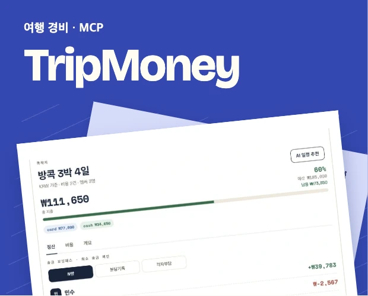
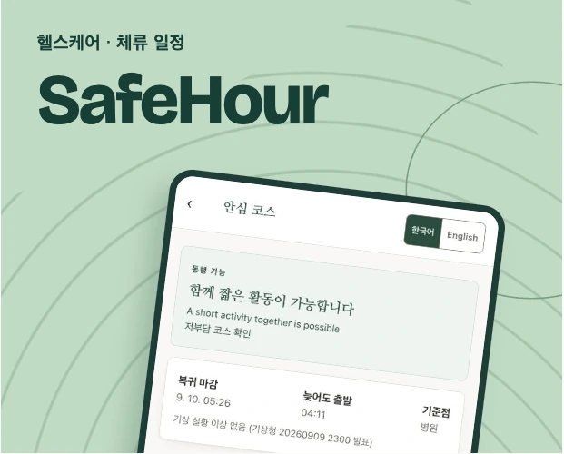
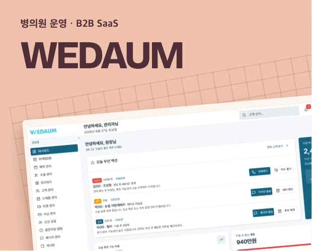

# 고재천 | 플랫폼 PO

병원 개발자로 시작해 지금은 보험 플랫폼 3개의 제품 정책과 개발 우선순위를 맡고 있습니다. 팀이 AI를 활용해 기획안을 시제품으로 만들고 검수하는 방식도 설계합니다.

[제품 포트폴리오 열기](https://kojaecheon.github.io/kojaecheon/)

  
  
  

## TripMoney | 여행 총무의 경비 정산

여행 총무가 마지막 날 영수증을 다시 맞춰보는 수고를 줄이고 싶었습니다. 지출마다 결제자와 분담자를 기록하고, 대화에서 MCP 도구를 호출해 누가 누구에게 얼마를 보내야 하는지 확인하도록 구현했습니다.

[정산 대시보드 열기](https://tripmoney-alpha.vercel.app/prototype) · [제품 기획서](https://github.com/kojaecheon/tripmoney-mcp/blob/main/docs/PRODUCT-STRATEGY-2026-06-29.md)

## SafeHour | 병원 복귀 시각에 맞춘 체류 일정

한국에 시술을 받으러 온 환자와 보호자를 위한 서비스입니다. 병원이 안내한 조건과 복귀 마감에 맞춰 외출 일정을 구성하고, 시간이 부족한 날에는 외출을 넣지 않도록 설계했습니다.

[체류 일정 서비스 열기](https://safehour.vercel.app/) · [일정 설계 규칙](https://github.com/kojaecheon/safehour/blob/main/docs/platform/ITINERARY_RULES.md)

## WEDAUM | 병의원 상담과 인계를 연결하는 CRM

넥서스랩을 창업해 병의원 CRM의 MVP를 출시하고 매출을 냈습니다. 상담이 끝난 뒤 다음 담당자가 진행 상태와 후속 조치를 확인할 수 있도록 코디네이터 업무 화면을 설계했습니다.

[CRM 로그인](https://wedaum-crm-2026.vercel.app/) · [상담 우선순위 화면](https://proposal.wedaum.com/img/crm/02-golden-time.webp?v=2)
